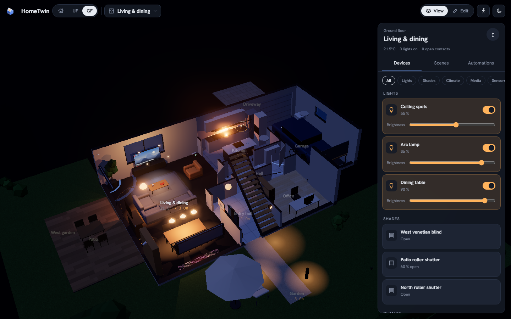
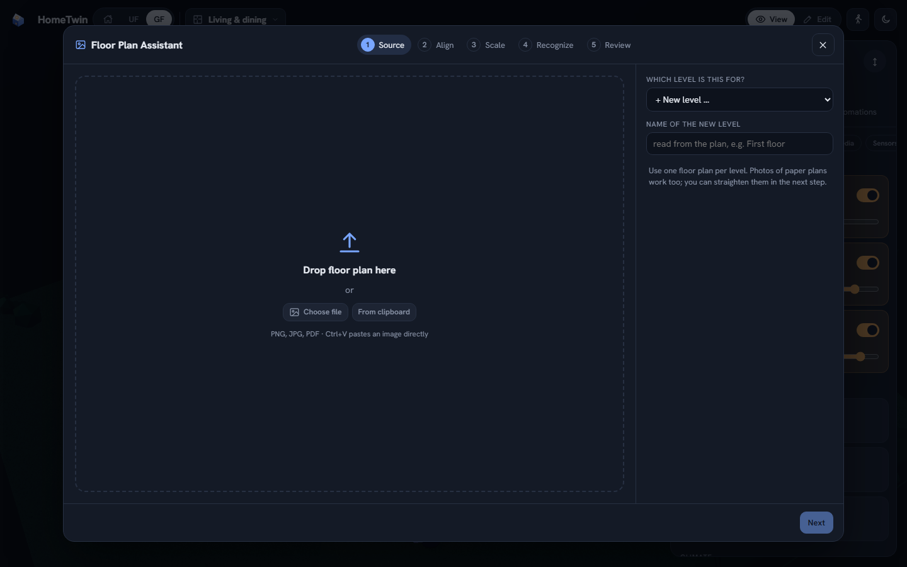
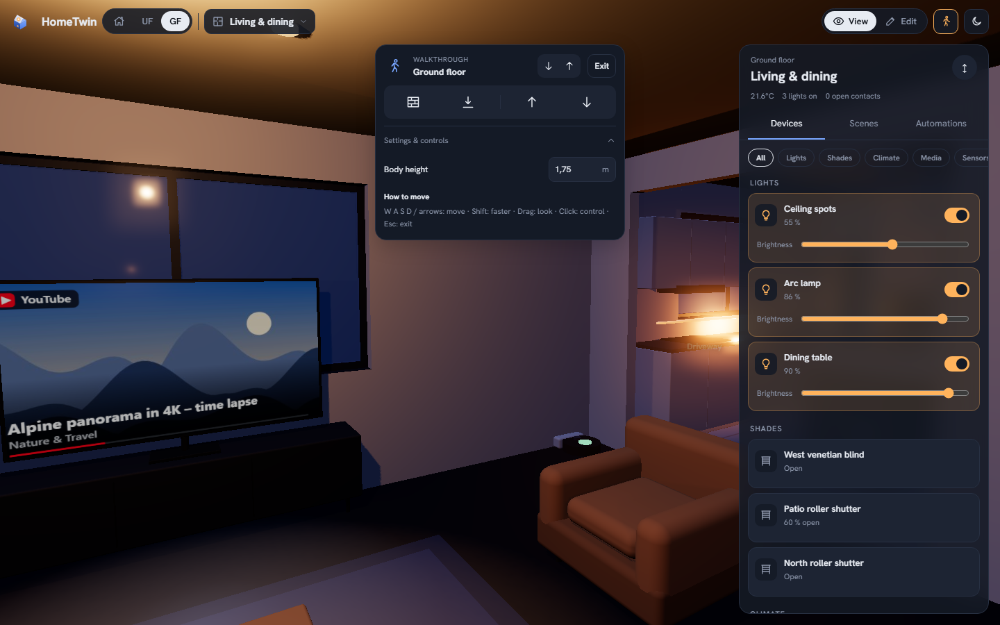
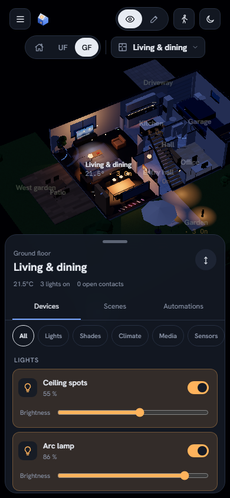
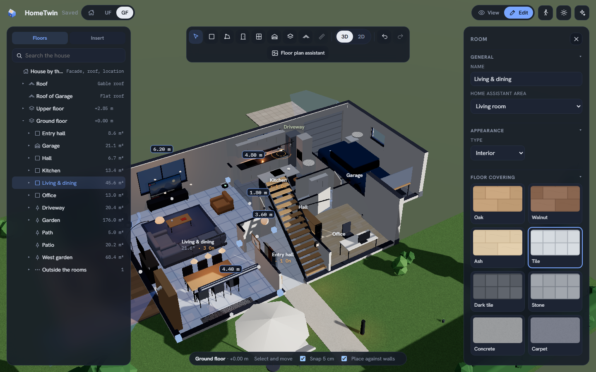
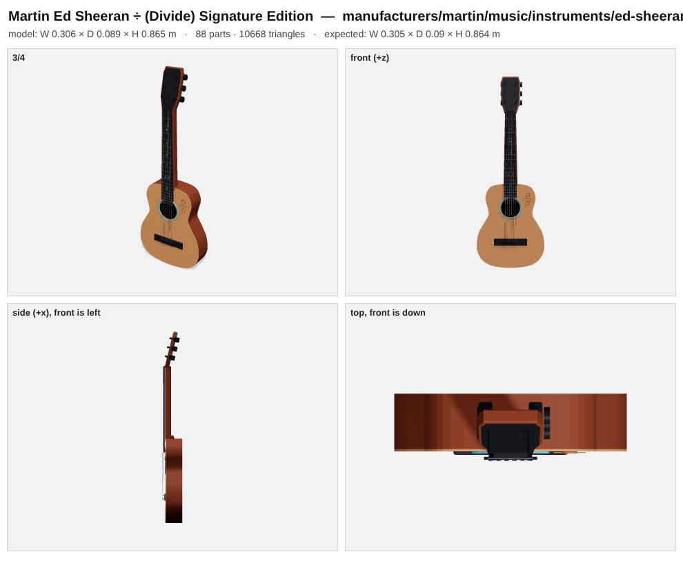

<p align="center">
  
</p>

<h1 align="center">HomeTwin</h1>

<p align="center"><b>Your home in 3D. One integration. A community that builds with you.</b><br>
HomeTwin is a community-driven, open-source 3D dashboard for Home Assistant. Build and review your plan in the visual editor, optionally let AI read a floor plan, and control devices where they belong.</p>

<p align="center">
  
  <a href="https://github.com/knaackee/hometwin/releases"></a>
  <a href="https://hacs.xyz"></a>
  <a href="LICENSE"></a>
  <a href="library/LICENSE"></a>
  <a href="https://github.com/knaackee/hometwin/stargazers"></a>
</p>

<p align="center">
  <a href="https://knaackee.github.io/hometwin/demo/"><b>▶️ Live demo</b></a> ·
  <a href="https://knaackee.github.io/hometwin/">🌐 Website</a> ·
  <a href="#-installation">🚀 Install</a> ·
  <a href="#-contribute-in-5-minutes">🧩 Contribute</a> ·
  <a href="README.de.md">🇩🇪 Deutsch</a>
</p>

<p align="center"></p>

> [!WARNING]
> **HomeTwin is a public beta.** It runs in daily use, but data formats can still change. Export a backup now and then (*Edit → House → Backup*). HomeTwin currently supports **English and German**. The interface defaults to English; choose German in the integration options. For setup help, see [Installation](#-installation). Want to improve HomeTwin? See [Contribute in 5 minutes](#-contribute-in-5-minutes).

## ✨ What it does
- 🏠 **Your house in 3D**: storeys, rooms, walls, windows, doors, connected stairs, roofs and garden. Build it from a floor plan or draw it by hand in the visual editor.
- 💡 **Room controls**: a responsive top-area picker shows room icons and live status. Control devices, scenes and area-assigned automations from layouts made for desktop, phones and wall tablets.
- 🤖 **Optional floor-plan AI**: reads rooms, doors, windows and scale from an architect's plan, including a self-check pass. You review and correct every result in the visual editor.
- 🚪 **Doors and windows**: choose models from the library, adjust generic frame colours and set shutter colours separately. Hover hints and the object tree help select small openings.
- 🎨 **Floor materials**: choose from eight procedural presets and adjust colour, direction, and plank or tile dimensions. Generated previews and bundled recipes work offline.
- ☀️ **Solar and roofs**: gable, hip, shed and flat roofs, dormers, roof windows and gutters. Arrange individual PV modules or rows, choose dimensions and portrait or landscape mounting.
- 🌤️ **Real sun and shadows** for your location and time of day.
- 🚶 **Connected walkthrough**: move between linked floors through stair openings while the complete house remains around you. Use the new menu for up/down movement and optional wall collision and gravity.
- 🧩 **Community extensions**: add furniture, products, doors, windows and floor materials through maintained contribution paths. The contribution skill guides additions; it is separate from the in-app floor-plan assistant.
- ✨ **What’s new**: review release highlights inside HomeTwin in English or German.
- ⌨️ **Placement tools**: move selected objects with the mouse or arrow keys; use height settings and automatic support placement for applicable objects.
- 💾 **Backup**: export and import the complete configuration as one file.

| Room controls | Floor-plan assistant | Walkthrough | Phone |
|---|---|---|---|
|  |  |  |  |

<p align="center"></p>

All screenshots show the built-in demo house, not a private home.

## ⚡ From floor plan to 3D in about 2 minutes

In our own test, a real architect's plan with **12 rooms and 16 openings was read in about two minutes** with `google/gemini-3.8-flash`. The AI found the rooms, doors and windows and took the scale from the printed dimension chains, so no measuring was needed.

1. **Source**: image, PDF, phone photo or clipboard.
2. **Align**: crop, rotate, straighten.
3. **Scale**: read from the dimension chains automatically, or measure one line.
4. **Recognise**: two passes. In the second, the AI checks its own result drawn on the plan.
5. **Review**: area warnings against the printed m², drag corners, add doors and windows by click. Then add the next storey and the roof, and watch the walls rise.

You don't need AI: the same assistant lets you trace the rooms yourself.

## 🚀 Installation

**HACS (recommended)**
1. HACS → ⋮ → *Custom repositories* → add `knaackee/hometwin` as **Integration**.
2. Install **HomeTwin**, then restart Home Assistant.
3. *Settings → Devices & services → Add integration → **HomeTwin***.
4. Open **HomeTwin** in the sidebar and start with the demo house or your floor plan.

**Manual**: copy `custom_components/hometwin` into `/config/custom_components/`, or unpack `hometwin.zip` from the [latest release](https://github.com/knaackee/hometwin/releases) into `/config/custom_components/hometwin/`. Then restart.

**AI (optional)**: in the integration options, set any OpenAI-compatible endpoint with image input. We recommend **Opus 5.5 or a comparably capable model with image understanding**.

> Coming from the preview called **Raumwerk**? HomeTwin takes over your plan, floor-plan images and AI settings automatically on first start. You can also use *Backup → export/import*. Remove Raumwerk afterwards.

**UI language:** Settings → Devices & services → HomeTwin → Configure → UI language. English is the default; German is also available. The choice applies to the HomeTwin panel independently of your Home Assistant profile language. Existing room and device names stay unchanged.

## 🧩 Contribute in 5 minutes

**You don't need 3D skills to add objects.** Give your coding agent (Claude, Codex or any agent that supports the open skill format) the skill [`skills/add-object/SKILL.md`](skills/add-object/SKILL.md) and a product name or a photo. The agent:

1. identifies the product (or picks a generic object if the exact model isn't clear),
2. researches the real dimensions,
3. models it as a small recipe of shapes,
4. renders a preview sheet and asks you to confirm,
5. opens the pull request.

<p align="center"></p>

From **a single phone photo** the skill recognised a *Martin Ed Sheeran ÷ (Divide) Signature Edition*, researched it and built this object: 20 frets at their real positions, ÷ inlays, rosette, bridge and six tuners, **in about five minutes**.

**Got some tokens to spare? Put them to work for the community.** Look around your home: what furniture or devices are missing from HomeTwin? Grab some product photos and use our [contribution guide](CONTRIBUTING.md) with **Opus 5.5 or a comparably capable model**. Bring a whole room’s collection if you like, and bundle it in one pull request. Let’s make HomeTwin better together.

### Maintained extension points

- **Furniture, decor and physical products:** declarative object-library recipes; non-opening recipes are inserted as visual library objects.
- **Home Assistant device visuals:** built-in entity-linked representations live in the frontend source and require an integration update.
- **Doors and windows:** declarative library recipes for the supported fixed-window and single-swinging-door opening contract.
- **Floor materials:** declarative procedural presets with generated snapshots and no downloaded textures; recipes work offline, and additions are bundled with an integration update.
- **Translations:** frontend, integration and runtime strings; a native speaker must review every string and the running UI before merge.

The [HomeTwin contribution skill](skills/add-object/SKILL.md) routes each extension type to its files, checks and review requirements. It helps contributors extend HomeTwin; the in-app floor-plan assistant separately builds and reviews your own home.

**Recommended model for asset generation:** Opus 5.5 or a comparably capable model with image understanding. Include the model used to generate each asset in the pull request.
**Translations welcome:** English and German are supported. AI-assisted translations are welcome only after a native speaker manually reviews every string and checks the UI. See the [translation contribution guide](CONTRIBUTING.md#translation-contributions) for files, checks and review requirements.

## 🗺️ Roadmap

- 🌍 **Community translations** beyond English and German
- 🔔 **Needs attention**: low batteries, offline devices, leaks and alarms, pulsing where they are
- 🎛️ **Device sheets**: colour wheel, blind tilt, thermostat, media controls
- 🛋️ **Parametric generic objects**: resize and restyle, later "adjust from photo"
- 🖥️ **Kiosk mode** for wall tablets
- 🏗️ Free-standing walls, per-wall rise animation, more roof shapes

Ideas and bugs: [issues](https://github.com/knaackee/hometwin/issues).

## 🤖 For developers and agents

Architecture, build, test and release steps are in **[AGENTS.md](AGENTS.md)**, written for humans and coding agents alike. Short version:

```bash
cd frontend && npm install && node build.mjs   # panel bundle + docs/demo/index.html
npm install && npm run validate                 # library checks (repo root)
```

## 📜 License and credits

- Code: [MIT](LICENSE). Object library: [CC0-1.0](library/LICENSE) unless an object states CC-BY-4.0.
- Built with [three.js](https://threejs.org) and [pdf.js](https://mozilla.github.io/pdf.js/).
- HomeTwin is an independent community project and not affiliated with Home Assistant or the Open Home Foundation. Product and brand names in the library are used only to describe objects.
