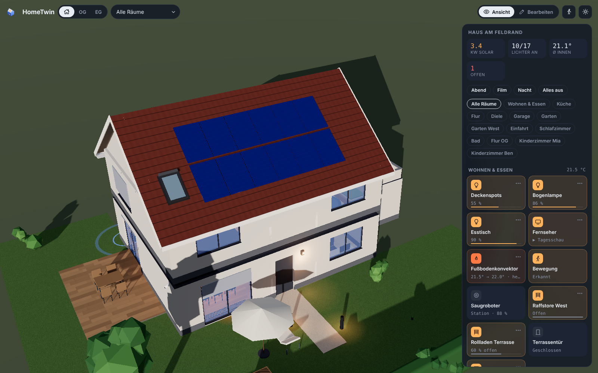

<p align="center">
  
</p>

<h1 align="center">HomeTwin</h1>

<p align="center"><b>Your home in 3D for Home Assistant.</b><br>
Upload your floor plan, let AI read the rooms, control every device right where it is.</p>

<p align="center">
  
  <a href="https://github.com/knaackee/hometwin/releases"></a>
  <a href="https://hacs.xyz"></a>
  <a href="LICENSE"></a>
  <a href="library/LICENSE"></a>
  <a href="https://github.com/knaackee/hometwin/stargazers"></a>
</p>

<p align="center">
  <a href="https://knaackee.github.io/hometwin/demo/"><b>▶️ Live demo</b></a> ·
  <a href="https://knaackee.github.io/hometwin/">🌐 Website</a> ·
  <a href="#-installation">🚀 Install</a> ·
  <a href="#-contribute-in-5-minutes">🧩 Contribute</a> ·
  <a href="README.de.md">🇩🇪 Deutsch</a>
</p>

<p align="center"></p>

> [!WARNING]
> **HomeTwin is a public beta.** It runs in daily use, but data formats can still change. Export a backup now and then (*Edit → House → Backup*). The user interface is currently **German**; English is the next milestone ([help welcome](#-roadmap)).

## ✨ What it does

- 🏠 **Your house in 3D**: storeys, rooms, walls, windows, doors, stairs, roofs, garden. Built from your floor plan or drawn by hand.
- 💡 **Live devices**: lights glow in their colour, blinds and garage doors move, open windows light up, PV panels shine with your solar output. Tap to toggle, long-press for Home Assistant's detail dialog.
- ☀️ **Real sun and shadows** for your location and time of day.
- 🤖 **Floor-plan AI**: rooms, doors, windows and the scale are read from an architect's plan, including a self-check pass.
- 🚶 **Walk through** your home at eye level and operate or rearrange things on the way.
- 🏡 **Several roofs**: gable, hip, shed or flat, plus garage, carport or garden house with their own roof. Add dormers and roof windows.
- 📱 **Phone and wall tablet ready**: bottom-sheet controls, room picker, touch gestures, performance mode.
- 🧩 **Community object library**: real products and generic furniture, modelled from real dimensions, updated live when new objects are merged.
- 💾 **Backup**: export and import the complete configuration as one file.

| Room view | Floor-plan assistant | Walkthrough | Phone |
|---|---|---|---|
|  |  |  |  |

## ⚡ From floor plan to 3D in about 2 minutes

In our own test, a real architect's plan with **12 rooms and 16 openings was read in about two minutes** with `google/gemini-3.8-flash`. The AI found the rooms, doors and windows and took the scale from the printed dimension chains, so no measuring was needed.

1. **Source**: image, PDF, phone photo or clipboard.
2. **Align**: crop, rotate, straighten.
3. **Scale**: read from the dimension chains automatically, or measure one line.
4. **Recognise**: two passes. In the second, the AI checks its own result drawn on the plan.
5. **Review**: area warnings against the printed m², drag corners, add doors and windows by click. Then add the next storey and the roof, and watch the walls rise.

You don't need AI: the same assistant lets you trace the rooms yourself.

## 🚀 Installation

**HACS (recommended)**
1. HACS → ⋮ → *Custom repositories* → add `knaackee/hometwin` as **Integration**.
2. Install **HomeTwin**, then restart Home Assistant.
3. *Settings → Devices & services → Add integration → **HomeTwin***.
4. Open **HomeTwin** in the sidebar and start with the demo house or your floor plan.

**Manual**: copy `custom_components/hometwin` into `/config/custom_components/`, or unpack `hometwin.zip` from the [latest release](https://github.com/knaackee/hometwin/releases) into `/config/custom_components/hometwin/`. Then restart.

**AI (optional)**: in the integration options, set any OpenAI-compatible endpoint with image input. We recommend **`google/gemini-3.8-flash`** via [OpenRouter](https://openrouter.ai) with reasoning *off* or *low*. Reading a plan takes 30–120 s.

> Coming from the preview called **Raumwerk**? HomeTwin takes over your plan, floor-plan images and AI settings automatically on first start. You can also use *Backup → export/import*. Remove Raumwerk afterwards.

## 🧩 Contribute in 5 minutes

**You don't need 3D skills to add objects.** Give your coding agent (Claude, Codex or any agent that supports the open skill format) the skill [`skills/add-object/SKILL.md`](skills/add-object/SKILL.md) and a product name or a photo. The agent:

1. identifies the product (or picks a generic object if the exact model isn't clear),
2. researches the real dimensions,
3. models it as a small recipe of shapes,
4. renders a preview sheet and asks you to confirm,
5. opens the pull request.

<p align="center"></p>

From **a single phone photo** the skill recognised a *Martin Ed Sheeran ÷ (Divide) Signature Edition*, researched it and built this object: 20 frets at their real positions, ÷ inlays, rosette, bridge and six tuners, **in about five minutes**.

**Our ask:** walk through your home, check what's missing in the [gallery](https://knaackee.github.io/hometwin/#library), and send it in. Please **bundle several objects per pull request** (e.g. 3–10 from one room); they get merged much faster. Details: [CONTRIBUTING.md](CONTRIBUTING.md).

## 🗺️ Roadmap

- 🌍 **English UI + i18n** (next), then community translations
- 🔔 **Needs attention**: low batteries, offline devices, leaks and alarms, pulsing where they are
- 🎛️ **Device sheets**: colour wheel, blind tilt, thermostat, media controls
- 🛋️ **Parametric generic objects**: resize and restyle, later "adjust from photo"
- 🖥️ **Kiosk mode** for wall tablets
- 🏗️ Free-standing walls, per-wall rise animation, more roof shapes

Ideas and bugs: [issues](https://github.com/knaackee/hometwin/issues).

## 🤖 For developers and agents

Architecture, build, test and release steps are in **[AGENTS.md](AGENTS.md)**, written for humans and coding agents alike. Short version:

```bash
cd frontend && npm install && node build.mjs   # panel bundle + docs/demo/index.html
npm install && npm run validate                 # library checks (repo root)
```

## 📜 License and credits

- Code: [MIT](LICENSE). Object library: [CC0-1.0](library/LICENSE) unless an object states CC-BY-4.0.
- Built with [three.js](https://threejs.org) and [pdf.js](https://mozilla.github.io/pdf.js/).
- HomeTwin is an independent community project and not affiliated with Home Assistant or the Open Home Foundation. Product and brand names in the library are used only to describe objects.
